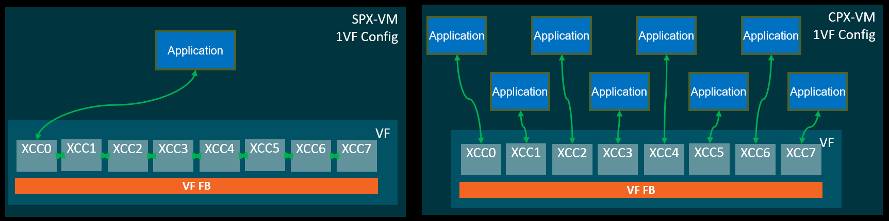
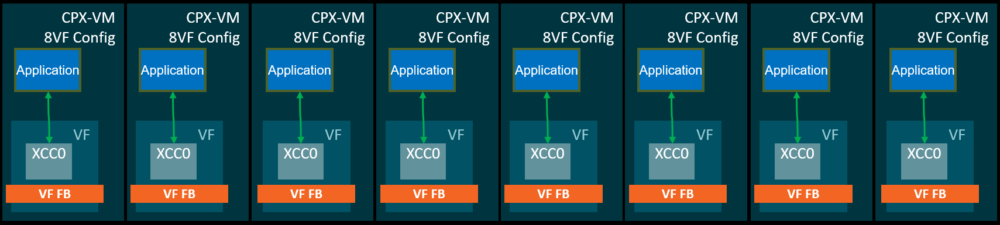

<!-- markdownlint-disable MD029 -->

# GPU partitioning

## Prerequisites

Before starting this guide, you must complete:

1. [Getting Started with Virtualization](Getting_started_with_MxGPU.md)
2. [Host Configuration](Host_configuration.md)

---

Supported partitioning types:

- **Spatial Partitioning:** Instinct MI300X, MI325X and MI350X/MI355X
- **Temporal Partitioning:** Radeon Pro V710

## Spatial partitioning

In a **non-monolithic** GPU architecture, multiple chiplets are integrated to form a cohesive unit. The arrangement of these chiplets is essential for understanding the overall architecture and its capabilities.

For programming simplicity, these distinct elements are presented to the programmer as a single logical device. However, for performance-critical applications, it may be beneficial for programmers to give up the convenience of this single-pool view. Instead, they can target kernels and memory allocations at the device's individual components.

Spatial partitioning enables programmers to selectively modify the logical view of the device. This primarily involves exposing the discrete architectural elements separately. In the case of MxGPU there are memory partitioning modes, which change the view of the memory, and compute partitioning modes which change the view of the compute.

To facilitate targeted resource management, GPUs support various partitioning modes that alter the logical view of the device. These modes can be categorized into two primary types:

- Compute Partitioning
- Memory Partitioning

### Compute partitioning

This refers to the logical partitioning of compute chiplets into distinct devices within the software stack. In the default mode, all compute chiplets are viewed as a single logical compute element. In a partitioned mode, each compute chiplet appears as a separate logical GPU, allowing for explicit scheduling and resource allocation for each individual compute element. MxGPU supports two ways of GPU compute resources partitioning:

#### Static compute partitioning

This method divides all GPU compute resources (like XCCs, Decoders, Encoders, DMA, JPEG engines) equally across the Virtual Functions (VFs) at driver load time. The partitioning is based on the number of VFs enabled, which can be configured as follows:

- 1 VF (SPX)
- 8 VFs (CPX)

To achieve the desired static compute partitioning, use the vf_num parameter with the modprobe command on driver load time. The command should be structured as follows:

```bash
# sudo modprobe gim vf_num=<number_of_vfs>
```

In this command, <number_of_vfs> indicates the number of VFs you want to set up.

If you do not specify the vf_num parameter, the default value of 1 will be used.

Ensure that the value you choose is supported by your specific GPU model. For more information, refer to the **Partitioning Support per GPU Model** section below.

#### Dynamic compute partitioning

This approach allows for the division of GPU compute resources within a single VF into multiple partitions, configurable as:

- 1 Partition (SPX)
- 2 Partitions (DPX)
- 8 Partitions (CPX)

To dynamically switch the compute partitioning mode, you can use the AMD SMI tool with the following command:

```bash
# sudo amd-smi set --accelerator-partition=<profile_index>
```

This command will only work if there are no guest VMs running. It sets the accelerator partition to a mode based on the specified profile_index.

You can retrieve the available profile_index numbers by executing the following command:

```bash
# sudo amd-smi partition --accelerator
```

Make sure to check the output of this command to select the appropriate profile_index for your needs.

#### Static and dynamic compute partitioning example

The interpretation of CPX mode may vary based on the platform and the capabilities of static compute partitioning (number of VFs). When the PF driver is loaded with a different VF number, a default setting will be applied when switching to CPX.

A visual representation illustrating how Dynamic Compute Partition Mode interacts with Static Compute Partitioning is provided below:

Dynamic Compute Partition Mode - 1 VF

- SPX - 8 XCC work together​

- CPX - each XCC works independently



Dynamic Compute Partition Mode - 8 VF

- CPX - each XCC works independently​



### Memory partitioning

Memory partitioning modes, known as Non-Uniform Memory Access (NUMA) Per Socket (NPS), change the number of NUMA domains that a device exposes, effectively altering the accessible memory space for compute units. This alteration affects the number of High-Bandwidth Memory (HBM) stacks accessible to a compute unit. Importantly, the number of memory partitions must be less than or equal to the number of compute partitions. For example, certain memory partitioning modes may only be enabled when specific compute partitioning modes are active, allowing for optimized memory access based on the architecture's capabilities.

This method divides the GPU memory into partitions based on the NPS modes, which can be set as:

- NPS1
- NPS2
- NPS4

To switch memory partition modes, you can again use the AMD SMI tool with the following command:

```bash
# sudo amd-smi set --memory-partition=<memory_partition_setting>
```

This command will only work if there are no guest VMs running. It sets the memory partition to one of the following options: NPS1, NPS2, or NPS4.

To view the available memory partition capabilities, you can run the following command:

```bash
# sudo amd-smi partition --memory
```

This will display the supported memory partition settings for your GPU and current compute partitioning mode.

In theory, if not restricted by hardware limitations, any combination of compute and memory partition modes is possible (with rule that the number of memory partitions must be less than or equal to the number of compute partitions). Still, some combinations are restricted for simplicity.

## Temporal partitioning (AMD Radeon PRO V710)

As a **monolithic** GPU, the AMD Radeon PRO V710 uses a fundamentally different approach to partitioning. It implements **temporal partitioning** through its Auto Scheduler, which time-slices the full GPU among active Virtual Functions (VFs).

Unlike true spatial partitioning where separate hardware blocks are permanently allocated to each workload, the V710 uses temporal partitioning that shares all hardware resources among VFs. Logical isolation is maintained while using shared execution units.

### VF support for temporal partitioning

Temporal partitioning supports 1-12 VFs. This range is chosen to provide an optimal experience. While the theoretical maximum is 31 VFs, the practical limit is constrained to improve performance.

To achieve the desired temporal partitioning, use the vf_num parameter with the modprobe command on driver load time. The command should be structured as follows:

```bash
# sudo modprobe gim vf_num=<number_of_vfs>
```

In this command, <number_of_vfs> indicates the number of VFs you want to set up.

If you do not specify the vf_num parameter, the default value of 1 will be used.

### Scheduling modes

The V710's Auto Scheduler supports multiple scheduling modes. The primary ones are:

- **Solid Mode:** Equal time slices allocated to all VFs

- **Liquid Mode:** Dynamic time slice adjustment based on each VF's workload requirements

#### Configure the scheduling mode

Set the scheduling mode at driver load time using the `sch_policy` module parameter. Provide the index of the desired scheduling mode:

```bash
# sudo modprobe gim sch_policy=<mode_index>
```

> **Note:**  If sch_policy is not specified, the default value 1 is used, which corresponds to Solid Mode.

All available scheduling modes and their corresponding indexes can be listed with:

```bash
# sudo modinfo gim
```

### Performance characteristics

**Key Differences from Spatial Partitioning:**

| Aspect            | Temporal Partitioning      | Spatial Partitioning                  |
|-------------------|----------------------------|---------------------------------------|
| **Division type** | Time-based                 | Hardware-based                        |
| **Execution**     | One workload at a time     | Multiple workloads run simultaneously |
| **Isolation**     | Strong temporal isolation  | Strong spatial isolation              |
| **Overhead**      | Context-switching          | Resource fragmentation                |

---

## Partitioning support per GPU model

### AMD Instinct MI300X/MI325X/MI35XX architecture

Spatial partitioning:

| Number of VFs per GPU    | Dynamic Compute Partitioning | NPS1                   | NPS2             | NPS4           |
|--------------------------|------------------------------|------------------------|------------------|----------------|
| 1 (8 VFs per node)       | SPX (Default)                | MI300X, MI325X, MI35XX |                  |                |
| 1 (8 VFs per node)       | DPX                          |                        | MI35XX           |                |
| 1 (8 VFs per node)       | CPX                          |                        | MI35XX           |                |
| 2 (16 VFs per node)      | DPX                          |                        | MI35XX           |                |
| 8 (64 VFs per node)      | CPX                          |                        | MI35XX           | MI300X         |

### AMD Instinct MI210X architecture

The AMD Instinct MI210 supports 1 VF per GPU, and does not support spatial or temporal partitioning.

**Supported:**

- SR-IOV with 1 Virtual Function (VF) per GPU

**Not Supported:**

- Compute Partitioning (no SPX/DPX/CPX modes)
- Memory Partitioning (no NPS modes)
- Multiple VFs per GPU

### AMD Radeon PRO V710

The AMD Radeon PRO V710 uses **temporal partitioning** exclusively.

---

## Next steps

After completing GPU partitioning, you can:

**[Virtual Machine Setup](VM_setup.md)** - Configure your VMs to use the partitioned VFs

**[XGMI Configuration](XGMI_configuration.md)** - See supported XGMI configurations, then proceed to VM Setup
