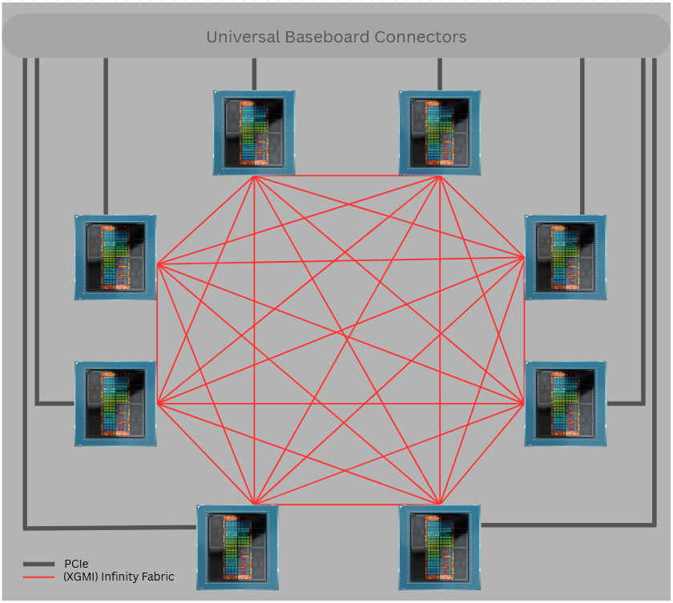
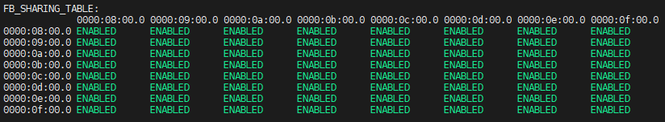
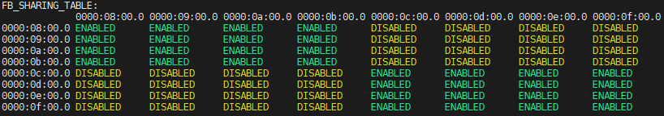

<!-- markdownlint-disable MD029 -->

# XGMI configuration

## Prerequisites

Before starting this guide, you must complete:

1. [Getting Started with Virtualization](Getting_started_with_MxGPU.md)
2. [Host Configuration](Host_configuration.md)
3. [GPU Partitioning](GPU_partitioning.md)

## Understanding XGMI

XGMI, or External Global Memory Interconnect, is AMD’s high-speed GPU-to-GPU interconnect based on [Infinity Fabric™ technology](https://docs.amd.com/v/u/en-US/AMD_Infinity_Fabric_Link_User_Guide_56978). It plays a crucial role in creating a coherent memory space across multiple GPUs, enabling efficient data transfer for high-performance computing (HPC) and artificial intelligence (AI) workloads.

According to the XGMI specification, XGMI serves as an inter-socket interface that maintains a bi-directional communication channel. This channel bridges coherent fabrics between multiple silicon instances, allowing for seamless data transfer. The physical XGMI connector is present on supported AMD GPUs, enabling the connection of multiple GPU cards into a homogeneous memory space. This memory space is constructed by joining the local VRAM of each peer GPU.

XGMI enables P2P transfers that are generally faster than those over PCIe, although performance may vary depending on the platform.



### Important consideration

It is important to note that XGMI is only available in a single Virtual Function (VF) mode. This means that the advantages of XGMI cannot be utilized if one GPU Physical Function (PF) is partitioned into multiple GPU VFs during driver load time.

## Frame buffer sharing modes

By default, the memory space of each GPU is visible to all other GPUs on the platform, creating a homogeneous memory space. However, this configuration can be altered, and GPUs can be organized into predefined frame buffer (FB) sharing modes to enhance security and resource management:

- MODE 8: All GPUs share their frame buffers with each other.
- MODE 4: GPUs are divided into two groups, with each group of four sharing their frame buffers.
- MODE 2: GPUs are divided into four groups, with each group of two sharing their frame buffers.
- MODE 1: No sharing of frame buffers between GPUs.

These settings are crucial for providing security when assigning VF resources to multiple virtual machines (VMs). By configuring the FB sharing modes, administrators can ensure that VF groups assigned to one VM do not have access to the frame buffers of other VFs unrelated to that VM.

### Switch between FB sharing modes

Switching between these settings can be accomplished using the AMD System Management Interface (SMI) tool commands. Below is an example command to change the FB sharing mode:

```bash
# sudo amd-smi set --xgmi --fb-sharing-mode=<mode>
```

Replace <mode> with the desired mode (MODE_1, MODE_2, MODE_4, MODE_8) to configure the frame buffer sharing according to your requirements.

MODE_X represents that X GPUs will be in the same group, linked together:

- MODE_1 (one GPU in a group)
- MODE_2 (two GPUs in a group)
- MODE_4 (four GPUs in a group)
- MODE_8 (eight GPUs in a group)

> **Note:** This command will only work if there is no guest VM running.

### VF group constraints

**Important:** FB sharing modes enforce **predefined VF groupings** - you cannot arbitrarily select any VFs to share frame buffers. The grouping is determined by the underlying GPU topology.

Key Constraints:

- **MODE 1**: No sharing constraints since each GPU operates independently
- **MODE 2**: Only specific pairs of GPUs can share frame buffers (not any random two VFs)
- **MODE 4**: Only predefined groups of four GPUs can share frame buffers
- **MODE 8**: All eight GPUs share frame buffers (no grouping constraints)

### Verify GPU topology and FB sharing

Before configuring VMs, you should verify which GPUs can share frame buffers in your chosen mode.

Use the AMD SMI topology command to examine FB sharing relationships:

```bash
# sudo amd-smi topology --fb-sharing
```

This command displays a **matrix** showing ENABLED/DISABLED status for FB sharing between each pair of GPUs. By default all GPUs share FB:



Using Topology Information:

1. **Set your desired FB sharing mode**
2. **Query the topology** to see which GPUs are grouped together
3. **Assign VFs** only from GPUs within the same sharing group to each VM

## VM configuration examples for 8-GPU platforms with XGMI links

When configuring VMs on an 8 GPU platform utilizing XGMI links, it is essential to consider the FB sharing modes to ensure data security and resource isolation. Below are several configuration examples that illustrate how to effectively assign VFs to VMs while leveraging XGMI capabilities.

> **Note:** Advantages of XGMI can only be utilized if driver is loaded with one VF. So for a platform with 8 GPUs, that makes 8 VFs in total.

### Configuration scenarios

| VM Count | VFs per VM | FB Mode | VF Assignment Strategy              | Topology Validation Required                |
|----------|------------|---------|-------------------------------------|---------------------------------------------|
| 1        | 8          | MODE 8  | All VFs to single VM                | None - all GPUs share FB                    |
| 2        | 4          | MODE 4  | **Must use predefined groups of 4** | **Required** - verify which 4 GPUs share FB |
| 4        | 2          | MODE 2  | **Must use predefined pairs**       | **Required** - verify which pairs share FB  |
| 8        | 1          | MODE 1  | Any single VF per VM                | None - no FB sharing                        |

### Workflow for multi-VM configurations

For configurations requiring topology validation (MODE 2 and MODE 4):

1. **Set FB sharing mode:**

   ```bash
   # sudo amd-smi set --xgmi --fb-sharing-mode=MODE_4  # or MODE_2
   ```

2. **Query topology to identify valid groups:**

   ```bash
   # sudo amd-smi topology --fb-sharing
   ```

   Output:

   

3. **Assign VFs based on topology results:**

   - **MODE 4**: Assign VFs only from GPU groups of 4 showing "ENABLED" relationships
   - **MODE 2**: Assign VFs only from GPU pairs showing "ENABLED" in the matrix

4. **Example for MODE 4:**

   If topology shows GPU0-GPU3 and GPU4-GPU7 groups are enabled:
   - VM1: Assign VFs from GPU0 to GPU3
   - VM2: Assign VFs from GPU4 to GPU7

By carefully selecting the appropriate FB sharing mode based on the number of VMs and VFs assigned, administrators can optimize resource utilization while ensuring data security and isolation. These configurations provide flexibility in managing workloads across an 8 GPU platform with XGMI links.

## XGMI support per GPU model

| GPU                        | Infinity Fabric (XGMI) Configuration |
|----------------------------|--------------------------------------|
| AMD Instinct MI350X/MI355X | Between 2/4/8 GPUs                   |
| AMD Instinct MI325X        | Between 2/4/8 GPUs                   |
| AMD Instinct MI300X        | Between 2/4/8 GPUs                   |
| AMD Instinct MI210X        | Between 4/8 GPUs                     |
| AMD Radeon Pro V710        | N/A                                  |

---

## Next steps

After completing XGMI configuration, proceed to:

**[Virtual Machine Setup](VM_setup.md)** - Configure your VMs to use the assigned VFs
